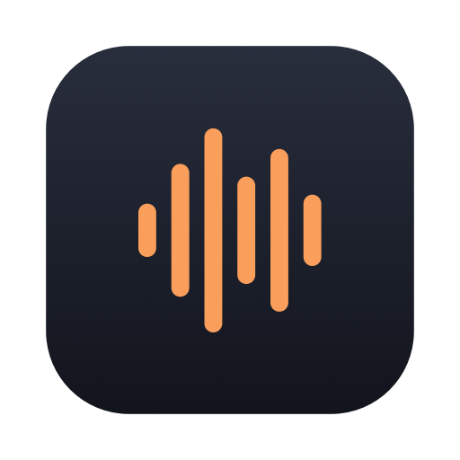
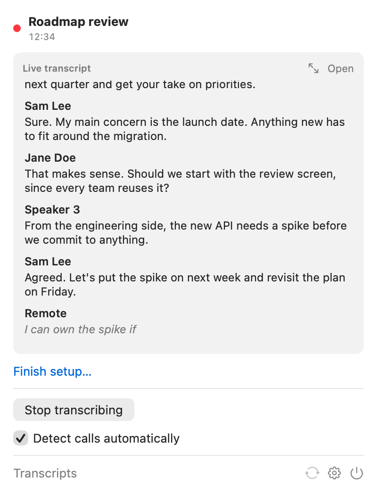
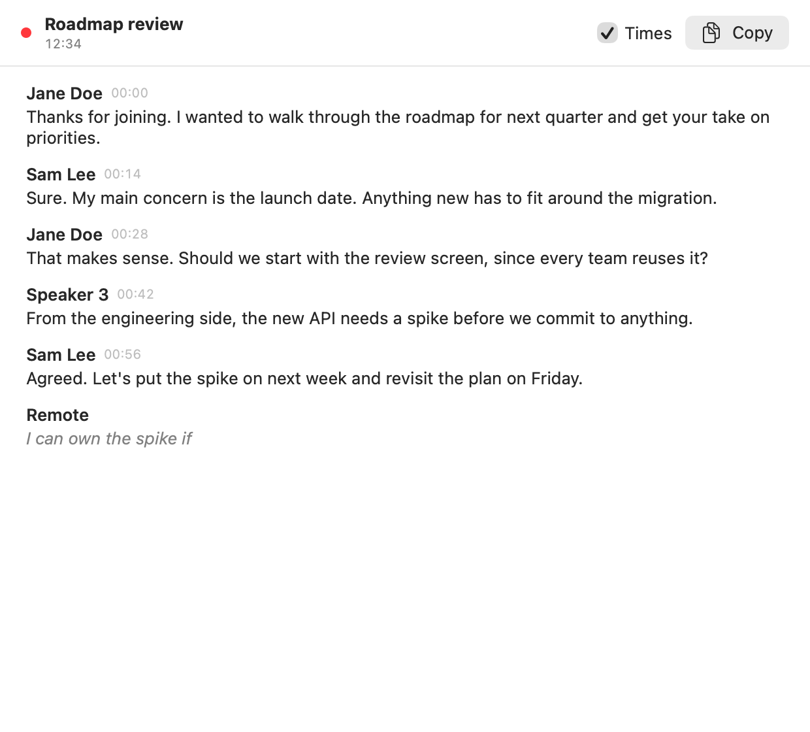

<p align="center"></p>

# ur.transcribe

Live call transcription for macOS that runs entirely on your Mac. ur.transcribe sits in the menu bar, starts when a call starts, writes down who said what as the call happens, and saves a plain-text transcript to the folder you choose.

No bot joins the call. No audio is uploaded, and no audio is ever written to disk. Only the text is saved.

<p align="center"> </p>

## What it does

- **Starts by itself.** When Zoom, Teams, Webex, Slack, FaceTime (or, optionally, a browser) opens your microphone, ur.transcribe starts transcribing. When the call app lets go of the mic, it finishes and saves.
- **Transcribes live, on device.** It uses Apple's SpeechAnalyzer (macOS 26), which runs on your Mac with no cloud service.
- **Knows who said what.** It works in layers, each one optional:
  1. **You.** Your microphone is its own stream, so your lines are always yours.
  2. **One-on-ones.** If the calendar event has one other attendee, every remote line is theirs.
  3. **Group calls.** A speaker diarization model ([Sortformer](https://huggingface.co/FluidInference/diar-streaming-sortformer-coreml) via [FluidAudio](https://github.com/FluidInference/FluidAudio)) separates up to four remote voices live, on the Neural Engine.
  4. **Names for those voices.** On Zoom, ur.transcribe reads who Zoom says is talking through the macOS Accessibility API and pins that name to the matching voice. Voices it cannot name keep stable labels like "Speaker 2".
- **Files itself.** Transcripts land in a default folder, or in a different folder per calendar or per title keyword (for example, work calendar calls go to one folder and studio calls to another).
- **Shows the conversation as it happens.** Open the menu bar icon for a live preview of the latest turns, or click **Open** for the full transcript in its own resizable window, with timestamps and copy.
- **Stays out of the way.** A small waveform in the menu bar, filled while it is transcribing.
- **Keeps itself up to date.** New versions install from inside the app, never in the middle of a call.

## Output

One markdown file per call, named `YYYY-MM-DD <event title>.md`, updated every few seconds while the call runs:

```
Meeting Title: Roadmap review
Date: Oct 20, 2026
Meeting participants: Jane Doe, Sam Lee, Priya Shah

Transcript:
Jane Doe: Thanks for joining. I wanted to walk through the roadmap for next quarter.
Sam Lee: Sure. My main concern is the launch date.
Speaker 3: From the engineering side, the new API needs a spike first.
```

Timestamps are an option in Settings.

## Requirements

- macOS 26 or later, on Apple Silicon
- Xcode 26 (to build)

## Install

### Download

1. Download `ur.transcribe-<version>-macos-arm64.dmg` from [Releases](https://github.com/arturyb1/ur.transcribe/releases).
2. Open it and drag **ur.transcribe** into **Applications**.
3. Open it from Applications and follow the setup window.

Releases are signed with a Developer ID and notarized by Apple, so they open without security warnings. A `.zip` of the same app is attached too.

After that, ur.transcribe updates itself. It checks once a day, and you can use **Check for Updates…** in the menu or in Settings. An update never restarts the app during a call; it waits until the transcript is saved.

### Build from source

```bash
git clone https://github.com/arturyb1/ur.transcribe.git
cd ur.transcribe
scripts/build-app.sh --install
open /Applications/ur.transcribe.app
```

The script builds a release binary, wraps it in `ur.transcribe.app`, signs it, and (with `--install`) copies it to `/Applications`.

By default the app is signed ad hoc. That works, but macOS ties permissions to the exact build, so it asks again after every rebuild. If you have an Apple Development or Developer ID certificate, sign with it instead:

```bash
SIGN_IDENTITY="Apple Development: Your Name (TEAMID)" scripts/build-app.sh --install
```

## First run

ur.transcribe opens a setup window that walks through everything it needs:

| Item | Why | Required |
|---|---|---|
| Microphone | Your side of the call | Yes |
| System audio | The other side of the call (macOS "System Audio Recording") | Yes |
| Speech model | Apple's on-device transcription model, one-time download from Apple | Yes |
| Calendar | Names the file, finds one-on-ones, picks the folder | No |
| Speaker model | Tells remote voices apart, one-time download (Hugging Face, with a GitHub mirror as fallback) | No |
| Accessibility | Reads Zoom's "who is talking" label for names | No |

You can also pick the destination folder and turn on "Open ur.transcribe when I log in" there.

macOS does not let apps read the system audio permission, so after you click **Request**, use **Check** to confirm ur.transcribe is enabled under System Settings, Privacy & Security, Screen & System Audio Recording.

## Settings

- **General**: open at login, auto-detect, automatic update checks, which apps to watch, language, timestamps, echo removal.
- **Folders**: the default folder, plus rules ("Calendar is Work" goes to one folder, "Title contains Studio" to another). The first matching rule wins.
- **Speakers**: your name, and each naming layer on or off. You can also tune the Zoom patterns here.

## Privacy

- Audio is processed in memory and discarded. ur.transcribe never writes audio files.
- Network use is limited to the one-time model downloads (Apple's speech assets, and the Sortformer model from Hugging Face). After that, ur.transcribe works offline.
- Transcripts are plain files in folders you choose. ur.transcribe keeps no other copy.

**Tell people you're transcribing.** Recording and transcription consent laws vary by place, and some require everyone on the call to agree. ur.transcribe gives the other side no notice of its own. If you use it on a work computer, check your company's policy first.

### Networks that block model downloads

Some work networks block Hugging Face, or both download sources. If the speaker model fails in setup, download `speaker-model-sortformer-v3-fp16.zip` from the [speaker model release](https://github.com/arturyb1/ur.transcribe/releases/tag/speaker-model-v1) on another network, copy it over, and use **From file…** in setup. It installs without any network.

## Known limits

- **Echo.** Without headphones, your mic also picks up the other side through your speakers. ur.transcribe drops mic lines that repeat what the remote stream said at the same moment, but headphones give the cleanest result.
- **Group calls.** The diarizer handles up to four remote voices and does best when people take turns. Heavy crosstalk, or very similar voices, can merge speakers.
- **Zoom names are best effort.** Zoom's accessibility labels vary by version and language. If names never appear, open Settings, then Speakers, then **Save Zoom accessibility snapshot** during a call. Find the text Zoom shows next to the active speaker and add a pattern for it. Pull requests with patterns for other Zoom versions are welcome.
- **Call end detection.** A call counts as over 45 seconds after the app releases the microphone. You can always stop by hand from the menu.

## Development

```bash
swift build                     # debug build
swift test                      # unit tests
scripts/build-app.sh            # app bundle in ./build
```

Two headless modes help when changing the pipeline or the UI:

```bash
# Feed audio files (played back to back) through transcription and diarization
.build/debug/URTranscribe --selftest a.aiff b.aiff c.aiff

# Render each screen to PNGs in light and dark
.build/debug/URTranscribe --snapshot /tmp/urtranscribe-shots
```

Quick self-test material: `say -v Samantha -o a.aiff "..."` and `say -v Daniel -o b.aiff "..."`.

### Layout

```
Sources/URTranscribe/
  App/            App entry, state, settings, permissions, call detection, the per-call session
  Audio/          Core Audio process tap (call app audio), microphone, format conversion
  Transcription/  SpeechAnalyzer wrapper, one per stream
  Speakers/       Diarization, calendar lookup, Zoom accessibility reader, name voting
  Output/         Markdown transcript writer, echo removal
  UI/             Menu bar panel, setup, settings
```

## Credits

- [FluidAudio](https://github.com/FluidInference/FluidAudio) (Apache 2.0) for on-device diarization.
- [Sparkle](https://sparkle-project.org) (MIT) for updates.
- NVIDIA's Sortformer streaming diarization model ([NVIDIA Open Model License](https://developer.nvidia.com/open-model-license)).
- Apple's Speech framework for transcription.

## License

MIT. See [LICENSE](LICENSE).
